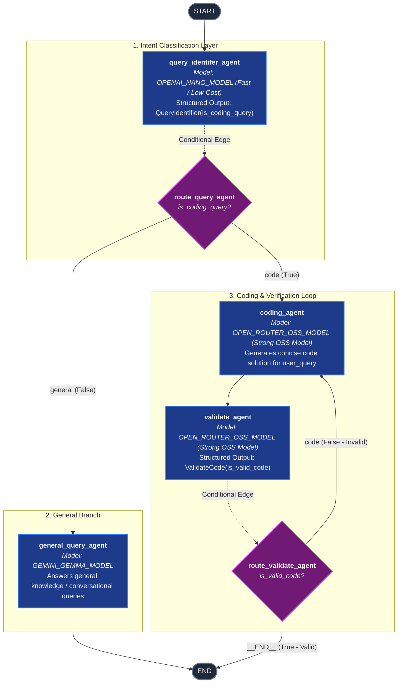

# Complex LangGraph Workflow Architecture

This document provides a comprehensive structural and logical breakdown of the LangGraph workflow implemented in [`chapter-5/complex_langgraph.py`](file:///Users/koushiksadhukhan/projects/genai-apps/chapter-5/complex_langgraph.py).

---

## 1. High-Level Overview

The application builds a multi-agent routing and validation pipeline using **LangGraph** and **OpenAI Structured Outputs (via OpenRouter)**. It demonstrates **model tiering / model specialization**:

1. **Lightweight / Low-Parameter Model (`OPENAI_NANO_MODEL`)**: Used for quick intent classification (`query_identifer_agent`), keeping latency and token costs minimal.
2. **Specialized General Query Model (`GEMINI_GEMMA_MODEL`)**: Handles non-coding conversational requests directly.
3. **High-Capacity / Strong OSS Model (`OPEN_ROUTER_OSS_MODEL`)**: Used for code generation (`coding_agent`) and rigorous code validation (`validate_agent`).
4. **Conditional Looping / Self-Correction**: If the code validation fails (`is_valid_code == False`), the workflow loops back to `coding_agent` to regenerate the solution.

---

## 2. Mermaid Workflow Diagram



---

## 3. Node & Edge Detailed Breakdown

### Graph State (`State`)
The workflow shares and mutates a common `TypedDict` state across all nodes:
```python
class State(TypedDict):
    user_query: str        # The raw query submitted by the user
    is_coding_query: bool   # Flag determined by query_identifer_agent
    is_valid_code: bool     # Flag determined by validate_agent
    result: str | None      # Stores model response text / generated code
```

---

### Nodes

| Node Name | Function Name | LLM Model | Structured Output Schema | Purpose & Role |
| :--- | :--- | :--- | :--- | :--- |
| **`query_identifer_agent`** | `query_identifer_agent` | `OPENAI_NANO_MODEL` (e.g., `openai/gpt-4.1-nano`) | `QueryIdentifier(is_coding_query: bool)` | Fast, lightweight triage agent that determines whether the query is programming-related. |
| **`general_query_agent`** | `general_query_agent` | `GEMINI_GEMMA_MODEL` (e.g., `google/gemma-4-31b-it`) | Standard text response | Responds to general non-coding queries and routes directly to `END`. |
| **`coding_agent`** | `coding_agent` | `OPEN_ROUTER_OSS_MODEL` (e.g., `openai/gpt-oss-120b`) | Standard text response | High-capability model prompted to solve coding questions concisely. |
| **`validate_agent`** | `validate_agent` | `OPEN_ROUTER_OSS_MODEL` (e.g., `openai/gpt-oss-120b`) | `ValidateCode(is_valid_code: bool)` | Inspects the generated code against the user's initial prompt and tests validity. |

> **Note on Registered Nodes vs Conditional Functions**:
> In [`chapter-5/complex_langgraph.py`](file:///Users/koushiksadhukhan/projects/genai-apps/chapter-5/complex_langgraph.py#L116-L121), `route_query_agent` and `route_validate_agent` were registered via `graph_builder.add_node()`, but they also serve as conditional routing functions in `add_conditional_edges()`.

---

### Edges & Routing Logic

1. **`START -> query_identifer_agent`** (Standard Edge)
   - Entry point: Passes `initial_state` with `user_query` into the classification agent.

2. **`query_identifer_agent -> route_query_agent`** (Conditional Edge)
   - **Condition**: Checks `state['is_coding_query']`.
   - **Branch `"code"`**: If `True`, routes to `coding_agent`.
   - **Branch `"general"`**: If `False`, routes to `general_query_agent`.

3. **`general_query_agent -> END`** (Standard Edge)
   - Query response is complete; execution terminates.

4. **`coding_agent -> validate_agent`** (Standard Edge)
   - After the code solution is generated and stored in `state["result"]`, it moves immediately to validation.

5. **`validate_agent -> route_validate_agent`** (Conditional Edge / Self-Correction Loop)
   - **Condition**: Evaluates `state["is_valid_code"]`.
   - **Branch `"__END__"`**: If `True` (valid code), routes to `END`.
   - **Branch `"code"`**: If `False` (invalid or incomplete code), routes back to `coding_agent` to retry/regenerate.

---

## 4. Execution Lifecycle Example

```
User Input: "Write a python function to check if a string is a palindrome"
 │
 ├── 1. query_identifer_agent (OPENAI_NANO_MODEL)
 │      └── Parsed: is_coding_query = True
 │
 ├── 2. route_query_agent evaluates True
 │      └── Routes to coding_agent
 │
 ├── 3. coding_agent (OPEN_ROUTER_OSS_MODEL)
 │      └── Generates palindrome function in state["result"]
 │
 ├── 4. validate_agent (OPEN_ROUTER_OSS_MODEL)
 │      └── Evaluates generated code against query -> is_valid_code = True
 │
 ├── 5. route_validate_agent evaluates True
 │      └── Routes to END
 └── Result returned to user
```
