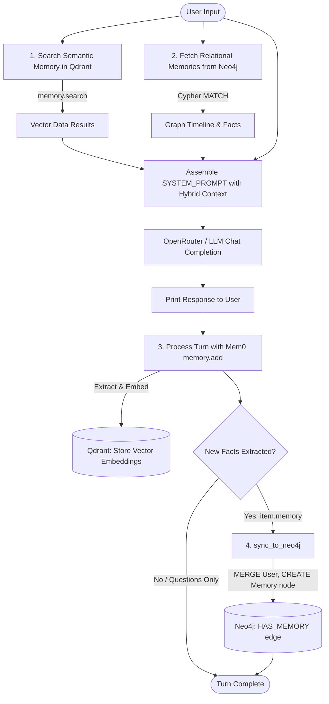

# Chapter 9: Hybrid Memory Agent (Qdrant Vector DB + Neo4j Graph DB)

A dual-store memory-aware AI assistant leveraging **Mem0** for semantic memory extraction and vector search in **Qdrant**, combined with a relational knowledge graph in **Neo4j** to track structured facts, entity relationships, and temporal timelines.

---

## 1. What We Are Building

A persistent conversational CLI assistant that remembers facts about the user across conversations. Instead of relying on a single memory paradigm, the assistant combines two complementary storage engines:

1. **Semantic Vector Search**: Finds memories conceptually similar to the current prompt, even if phrased differently.
2. **Relational Knowledge Graph**: Preserves relationships, timestamps, and multi-hop connections (e.g., users, facts, preferences, social connections).

When a user chats with the assistant:
- Relevant semantic memories are fetched from **Qdrant**.
- Recent relational facts and timelines are queried from **Neo4j**.
- Both contexts are injected into the LLM system prompt.
- Mem0 analyzes the conversation turn, extracts new facts (ignoring questions or chit-chat), saves the vector embedding in Qdrant, and syncs the structured fact node to Neo4j.

---

## 2. Why Use 2 Different Databases?

| Feature | Qdrant (Vector DB) | Neo4j (Graph DB) |
| :--- | :--- | :--- |
| **Primary Strength** | Semantic similarity & fuzzy meaning matching | Relationships, topology & graph traversals |
| **Query Mechanism** | Cosine similarity on dense embedding vectors | Cypher pattern matching (`MATCH (u)-[:HAS_MEMORY]->(m)`) |
| **Best For** | *"What did the user mention about their tech stack or hobbies?"* | *"Who is connected to whom?", "What facts were recorded recently in order?"* |
| **Limitation** | Struggles with explicit multi-hop entity relationships and strict graph patterns | Cannot easily match fuzzy meaning or semantic similarity without vector indexes |
| **Role in this App** | Contextual relevance search via Mem0 | Entity-centric timeline and relational memory backbone |

Combining both provides **Hybrid Memory**: Qdrant provides semantic breadth, while Neo4j provides relational depth and chronological clarity.

---

## 3. Architecture & Infrastructure

The two databases are orchestrated locally via Docker Compose:

- **[qdrant-neo4j-docker-compose.yml](file:///Users/koushiksadhukhan/projects/genai-apps/chapter-9/qdrant-neo4j-docker-compose.yml)**
  - **Qdrant (`qdrant/qdrant:latest`)**:
    - Port `6333`: REST API & Web Dashboard
    - Port `6334`: gRPC
    - Volume: `./qdrant_storage:/qdrant/storage`
  - **Neo4j (`neo4j:latest`)**:
    - Port `7474`: Browser UI (`http://localhost:7474`)
    - Port `7687`: Bolt protocol for Python driver
    - Auth: `NEO4J_AUTH: "none"` (for local development)
    - Plugins: APOC & Graph Data Science (`apoc`, `graph-data-science`)
    - Volume: `./neo4j/data` and `./neo4j/logs`

---

## 4. Code Flow

The diagram below illustrates the end-to-end execution flow in [chapter-9/main.py](file:///Users/koushiksadhukhan/projects/genai-apps/chapter-9/main.py):



---

## 5. Development Journey: Challenges & Resolutions

During development and integration, several practical challenges arose:

### 1. OpenAI Missing Credentials with Custom Base URLs
- **Challenge:** Initializing Mem0 failed with `openai.OpenAIError: Missing credentials` because Mem0 defaults to OpenAI's public API endpoints without default credentials.
- **Resolution:** Explicitly passed custom `api_key` and `openai_base_url` within both `config["llm"]["config"]` and `config["embedder"]["config"]` in [chapter-9/main.py](file:///Users/koushiksadhukhan/projects/genai-apps/chapter-9/main.py).

### 2. Missing spaCy Lemmatization Model
- **Challenge:** Mem0 raised `Failed to load spaCy lemma model: spaCy is not installed` when processing extracted facts.
- **Resolution:** Installed `spacy` and downloaded the required language model (`en-core-web-sm==3.8.0`).

### 3. Qdrant Vector Dimension Mismatch (1536 vs 3072)
- **Challenge:** Qdrant returned `HTTP 400: Vector dimension error: expected dim: 1536, got 3072`. Mem0 defaulted collection creation to 1536 dimensions, whereas `text-embedding-3-large` outputs 3072 dimensions.
- **Resolution:**
  1. Deleted the stale collection via `DELETE http://localhost:6333/collections/memory_app`.
  2. Set `"embedding_model_dims": 3072` explicitly in `config["vector_store"]["config"]`.

### 4. Mem0 v2.x Graph Store Deprecation
- **Challenge:** Mem0 v2.x deprecated external `graph_store` configuration in the open-source library, ignoring direct Neo4j configs passed to `Memory.from_config()`.
- **Resolution:** Decoupled graph operations by using the official `neo4j` Python driver (`GraphDatabase.driver`). Mem0 handles fact extraction and vector indexing, while custom helper functions (`sync_to_neo4j` and `get_graph_memories`) handle Neo4j persistence and retrieval.

### 5. Filtering Raw User Questions from Graph Persistence
- **Challenge:** If user inputs like *"What is my name?"* were synced directly to Neo4j, the graph would get polluted with questions rather than persistent facts.
- **Resolution:** Captured the return value of `memory.add(...)`, which runs an internal LLM extraction prompt. Only parsed facts (`item["memory"]`) are synced to Neo4j, ensuring only verified user attributes and statements are stored.

---

## 6. How to Run

A convenient [makefile](file:///Users/koushiksadhukhan/projects/genai-apps/chapter-9/makefile) is provided in `chapter-9` to orchestrate both database containers and verify their health.

### Step 1: Manage Database Containers with `make`

From inside the `chapter-9` directory:

```bash
# Start both Qdrant and Neo4j containers in the background
make db-up

# Check the running status of both containers
make db-status

# (Optional) Follow container logs live
make db-logs

# (When finished) Stop and teardown containers
make db-down
```

### Step 2: Verify Web Dashboards

Once `make db-up` is executed, both database dashboards become accessible:
- **Qdrant Web UI**: [http://localhost:6333/dashboard](http://localhost:6333/dashboard)
- **Neo4j Browser UI**: [http://localhost:7474](http://localhost:7474) (Connect with authentication: `None`)

### Step 3: Run the Application

In the same directory, run the Python application using `uv`:

```bash
uv run main.py
```
